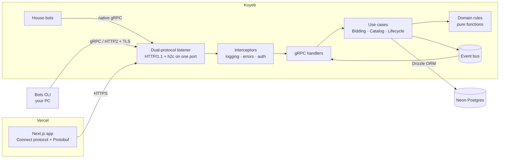

# ☕ Café Subasta — real-time coffee auction over gRPC

A live auction for Colombian specialty coffee micro-lots, built **contract-first** with
**gRPC + Protocol Buffers + HTTP/2**. Buyers bid from the browser while trading bots
compete over native gRPC. Every price on screen arrives through a long-lived gRPC stream.

| Layer | Tech | Hosting (free) |
|---|---|---|
| Contract (SSOT) | `proto/` + Buf code generation | — |
| Frontend | Next.js 16 + React 19 + ConnectRPC web client | Vercel |
| API | Node.js + ConnectRPC (gRPC, gRPC-Web and Connect on one port) | Koyeb (Docker) |
| Database | Postgres via Drizzle ORM (in-memory fallback) | Neon |
| Validation | Zod (shared by browser and server) | — |

---

## Why gRPC here

REST exposes *resources* (`POST /lots/42/bids`). gRPC exposes *functions*:
the browser literally calls `biddingClient.placeBid({...})` like a local method,
generated from the contract.

| Pillar | Where you can see it |
|---|---|
| **Protocol Buffers** (binary, compact) | *Under the hood* page measures the same response as Protobuf vs JSON, live (≈60% smaller). |
| **HTTP/2 multiplexing** | Bots keep one HTTP/2 connection with many concurrent streams (session + unary calls). |
| **Contract-first / SSOT** | `proto/coffee/auction/v1/auction.proto` is written first; server, web and bots import the generated code from `packages/contracts`. |
| **Code generation** | `npm run generate` (Buf + `protoc-gen-es`). CI fails if generated code is stale. |
| **End-to-end typing** | Postgres column → Drizzle row type → domain model → Protobuf message → React props. |
| **Runtime validation (type erasure)** | Zod checks env vars, form input, request semantics and `localStorage` data — the places where TypeScript types do not exist at runtime. |

### The four call types — all used

| Pattern | RPC | Used by |
|---|---|---|
| Unary | `ListLots`, `GetLot`, `RegisterBidder`, `GetMe`, `PlaceBid` | Browser + bots |
| Server streaming | `WatchFloor`, `WatchLot` | Browser (live floor and lot pages) |
| Client streaming | `SubmitAbsenteeBook` | Bots upload many proxy bids in one stream |
| Bidirectional | `BidderSession` | Bots: bids go up, lot events come down on the same stream |

> Browsers cannot speak native gRPC (no access to HTTP/2 trailers from `fetch`).
> The web app uses the **Connect protocol** with binary Protobuf, served by the
> **same** handlers. Client-streaming and bidi are shown with the Node.js bots,
> which talk **native gRPC over HTTP/2**.

---

## Architecture



```
proto/                         ← the contract (single source of truth)
packages/contracts/            ← generated code + shared Zod schemas + money helpers
apps/server/
  src/domain/                  ← business rules, pure & unit-tested
  src/application/             ← use cases (bidding, lifecycle, stats)
  src/infrastructure/          ← repositories (memory / Postgres), event bus, mutex, clock
  src/transport/               ← gRPC handlers, mappers, interceptors, dual-protocol server
  drizzle/                     ← SQL migrations
apps/web/                      ← Next.js frontend
apps/bots/                     ← trading bots (native gRPC client)
```

**Patterns used:** Hexagonal architecture (ports & adapters), Repository, Unit of Work,
Strategy (bot personas), Observer (event bus), Interceptor/middleware, Mapper,
Composition root (manual DI), CQRS-lite (catalog vs bidding), Idempotency keys,
per-lot mutex (no lost updates), State machine (lot lifecycle).

### Business rules

- **Tiered increments**: below $10/lb → $0.10, below $25 → $0.25, below $50 → $0.50, then $1.00.
- **Anti-sniping (soft close)**: a bid in the last 30 s extends the lot to *now + 30 s* (max 20 times).
- **Secret reserve**: the lot is sold only if the hammer price reaches it; clients only see "reserve met".
- **Credit line**: price × weight across every lot you are leading must stay under your credit.
- **Proxy bidding**: leave a maximum; the house answers rival bids one step at a time. The higher maximum wins and pays one step over the other; ties go to the earlier proxy.
- **Absentee book**: proxies can be armed before a lot opens; they fire at the opening.
- **Idempotent bids**: retrying a request with the same key never bids twice.
- Money is always **integer cents** — never floats.

---

## Run locally

Requirements: **Node.js 22 LTS** (20.11+ works) and npm.

```bash
npm install
npm run dev          # API on http://localhost:8080 + web on http://localhost:3000
```

Optional, in another terminal — bots from your machine over native gRPC:

```bash
npm run bots -- --count 4
```

Other commands:

```bash
npm test             # 31 tests: domain rules, proxy engine, 4 RPC types × 3 protocols, Postgres
npm run typecheck
npm run generate     # regenerate TypeScript from the .proto
npm run lint:proto   # Buf lint
```

Call the API like a gRPC client would (no browser):

```bash
npx buf curl --protocol grpc --http2-prior-knowledge --schema proto \
  http://localhost:8080/coffee.auction.v1.CatalogService/ListLots -d "{}"
```

---

## Deploy (all free tiers)

1. **Neon** → create a project, copy the connection string (`postgresql://...sslmode=require`).
2. **Koyeb** → *Create Web Service* → GitHub repo → builder **Dockerfile** (repo root).
   - Port **8000**, protocol **HTTP/2** (needed for native gRPC from outside).
   - Env vars: `DATABASE_URL`, `CORS_ORIGINS=https://*.vercel.app`, `HOUSE_BOTS=true`.
   - Health check: TCP on 8000.
3. **Vercel** → import the repo → *Root Directory* `apps/web` →
   env var `NEXT_PUBLIC_API_URL=https://<your-service>.koyeb.app` → Deploy.
4. Bots against the cloud: `npm run bots -- --target https://<your-service>.koyeb.app`.

Migrations run automatically when the API starts with a `DATABASE_URL`.

## Trade-offs

- **One API instance.** The event bus and the per-lot lock live in memory. To scale out,
  replace them with Postgres `LISTEN/NOTIFY` (or Redis/NATS) and `SELECT … FOR UPDATE`;
  the use cases would not change.
- **Browser = Connect, not raw gRPC.** That is a browser limitation, not a design choice.
  The server speaks all three protocols from the same handlers.
- **Free tier cold starts.** An idle free instance may sleep; streams reconnect on their own.
